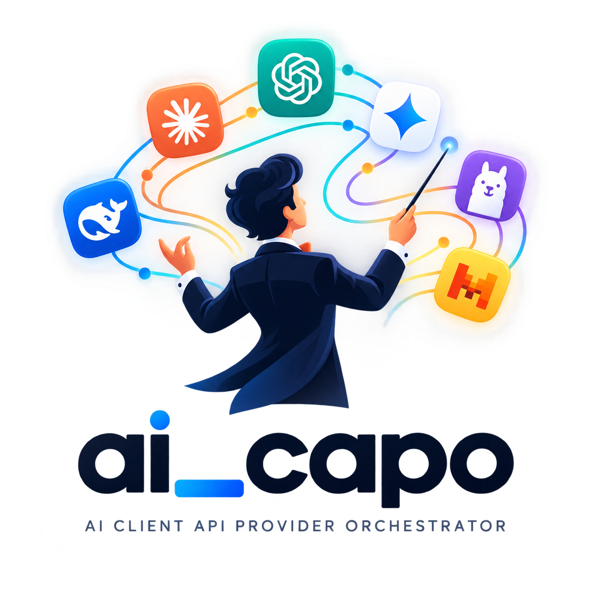

# AI Capo: AI Client API Provider Orchestrator

<p align="center">
  
</p>

A unified Flutter/Dart API for multiple Generative AI providers. AI Capo simplifies LLM integration by providing a clean, pluggable architecture for OpenAI, Anthropic Claude, Google Gemini, Ollama, Mistral, and DeepSeek.

## Features

- **Multi-Provider Support**: Switch between OpenAI, Anthropic, Google, Ollama, Mistral, and DeepSeek.
- **Unified Interface**: All providers implement the same `AIProvider` abstraction.
- **Streaming**: Full streaming support for real-time responses.
- **Lazy Initialization**: Providers are created on first request and cached.
- **Structured Output**: JSON Schema enforcement via `ResponseFormat` across all providers.

## Getting Started

Add `ai_capo` to your `pubspec.yaml`:

```yaml
dependencies:
  ai_capo: ^1.0.0
```

Run `flutter pub get`.

## Usage

### 1. Create an AIClient

```dart
import 'package:ai_capo/ai_capo.dart';

final client = AIClient();
```

### 2. Configure Your API Key

Pass a config when requesting a provider:

```dart
final config = AIConfig(apiKey: 'your-api-key');
```

### 3. Generate a Response

```dart
final provider = client.getProvider(ProviderType.openai, config);
final response = await provider.chatCompletion(
  messages: [ChatMessage.user('What is Flutter?')],
  options: const ChatCompletionRequest(
    model: 'gpt-5-mini-2025-08-07',
    temperature: 0.7,
    maxTokens: 500,
  ),
);

print(response.choices.first.content);
```

### 4. Switch Providers

```dart
final anthropic = client.getProvider(ProviderType.anthropic, config);
final response = await anthropic.chatCompletion(
  messages: [ChatMessage.user('Hello, Claude!')],
);
```

### 5. Stream a Response

```dart
final provider = client.getProvider(ProviderType.openai, config);

await for (final chunk in provider.streamChatCompletion(
  messages: [ChatMessage.user('Write a short poem.')],
  options: const ChatCompletionRequest(model: 'gpt-5-mini-2025-08-07', temperature: 0.8),
)) {
  print(chunk.content);
}
```

### 6. Use a System Prompt

```dart
final provider = client.getProvider(ProviderType.openai, config);
final response = await provider.chatCompletion(
  messages: [
    ChatMessage.system('You are a helpful Python tutor.'),
    ChatMessage.user('How do list comprehensions work?'),
  ],
);
```

---

## Structured Output

Structured output lets you enforce a JSON schema on the model's response. Use the `ResponseFormat` model via `responseFormat`. Each provider translates it into its own wire format (`response_format` for OpenAI/DeepSeek/Mistral, `output_config` for Anthropic, `responseJsonSchema` for Google, `format` for Ollama).

### JSON object mode

Pass `ResponseFormatType.jsonObject` to request plain JSON output:

```dart
final response = await provider.chatCompletion(
  messages: [ChatMessage.user('List 3 colors.')],
  options: ChatCompletionRequest(
    model: 'gpt-5-mini-2025-08-07',
    responseFormat: const ResponseFormat(type: ResponseFormatType.jsonObject),
  ),
);

// response.choices.first.content is a JSON string
```

Supported by: OpenAI, DeepSeek, Mistral, Ollama, Google.
Anthropic does not support schema-less JSON output — use `jsonSchema` instead.

### JSON Schema mode

Pass `ResponseFormatType.jsonSchema` with a `schema`:

```dart
final response = await provider.chatCompletion(
  messages: [
    ChatMessage.system('Extract info from the text.'),
    ChatMessage.user('The iPhone 16 costs $999 and was released in September 2024.'),
  ],
  options: ChatCompletionRequest(
    model: 'gpt-5-mini-2025-08-07',
    responseFormat: ResponseFormat(
      type: ResponseFormatType.jsonSchema,
      name: 'product_info',
      strict: true,
      schema: {
        'type': 'object',
        'properties': {
          'name': {'type': 'string'},
          'price': {'type': 'number'},
          'release_date': {'type': 'string'},
        },
        'required': ['name', 'price', 'release_date'],
        'additionalProperties': false,
      },
    ),
  ),
);

print(response.choices.first.content);
```

Supported by: OpenAI, DeepSeek, Mistral, Ollama, Google, Anthropic.

`name` and `strict` are optional and only used by providers that support them. `schema` is required when `type` is `jsonSchema`; passing a null schema throws an `ArgumentError`.

---

## **Contribution**

Feel free to open an issue or submit a pull request on GitHub.

## License

This project is licensed under the MIT License. See `LICENSE` for details.
